# LearnSphere

A Flutter learning portal with learner and administrator accounts, course authoring,
enrolment, and lesson progress tracking. Data lives in three JSONBin bins.

## Screen recording

<a href="https://drive.google.com/file/d/1psu9Ue_Ys7bhKXG91ChnbACcCucpdrTe/view?usp=sharing" target="_blank" rel="noopener noreferrer">Watch the LearnSphere screen recording</a>

## Screenshots

The app in action on Android, covering sign-in, administration, course discovery,
learning progress, and profile editing. Select any screenshot to view it at full size.

### Sign-in and administrator workspace

| Sign-in | Admin dashboard |
| --- | --- |
| [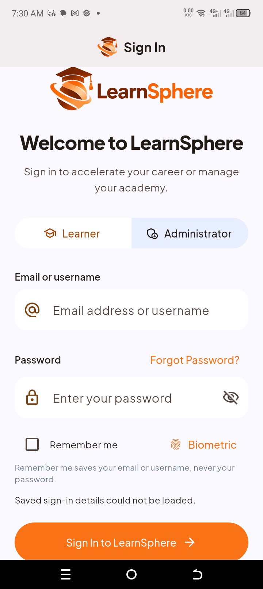](assets/images/screenshots/Screenshot_20261019-073052.png) | [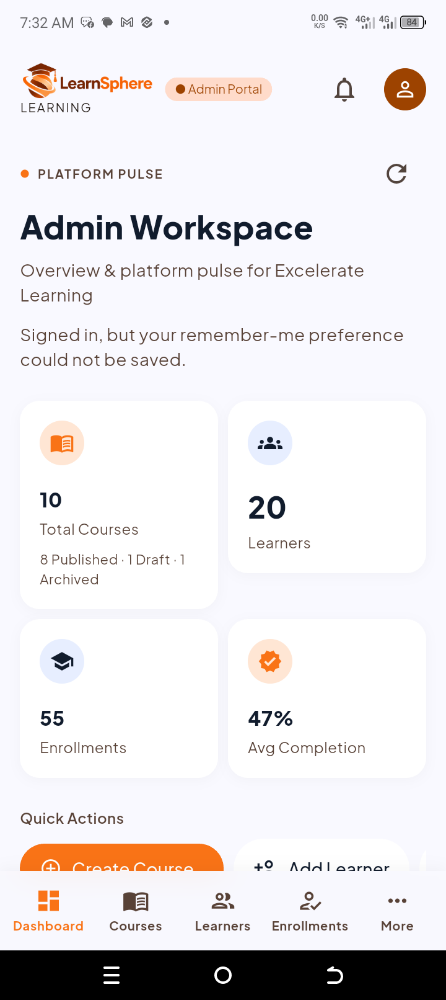](assets/images/screenshots/Screenshot_20261019-073200.png) |

| Course management | Create a course |
| --- | --- |
| [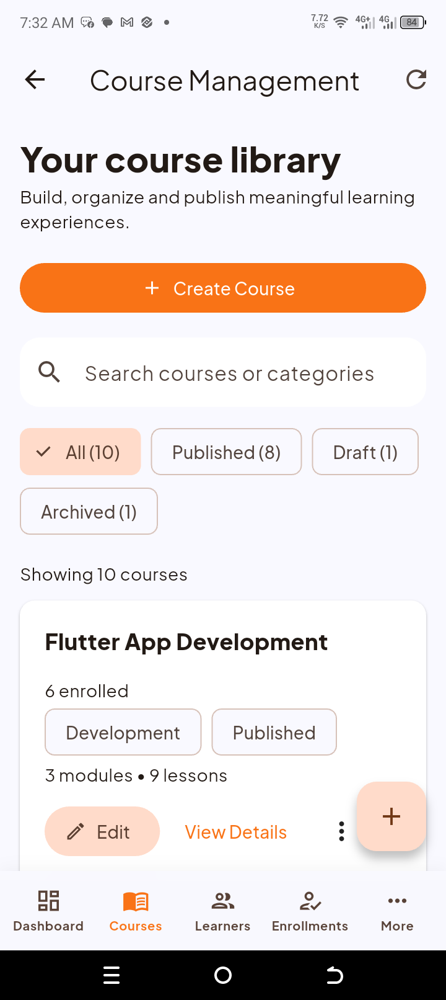](assets/images/screenshots/Screenshot_20261019-073214.png) | [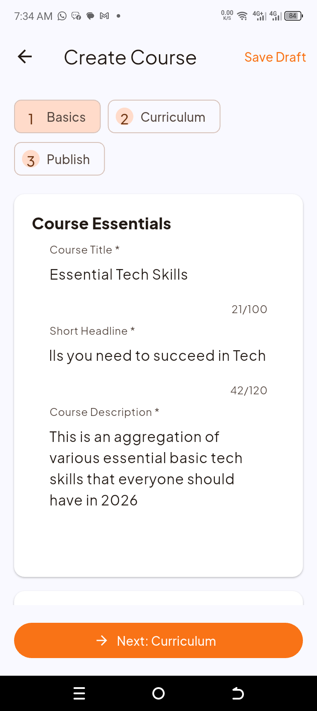](assets/images/screenshots/Screenshot_20261019-073412.png) |

| Learner management | Enrolment management |
| --- | --- |
| [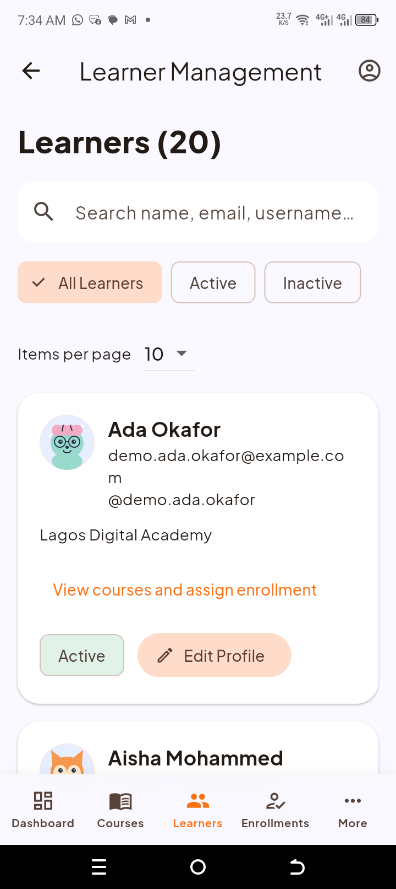](assets/images/screenshots/Screenshot_20261019-073430.png) | [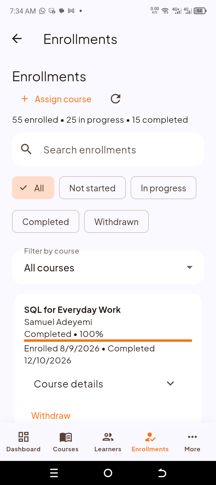](assets/images/screenshots/Screenshot_20261019-073449.png) |

### Course details and curriculum

| Course overview | Learning outcomes and curriculum |
| --- | --- |
| [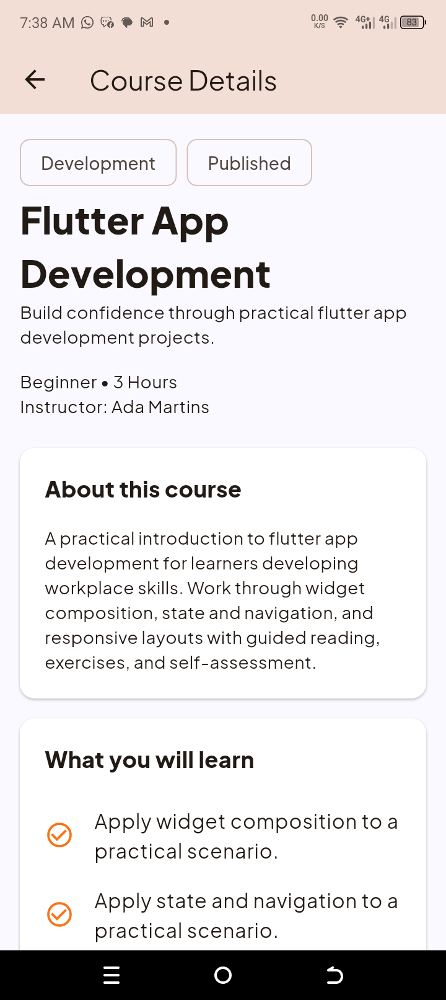](assets/images/screenshots/Screenshot_20261019-073809.png) | [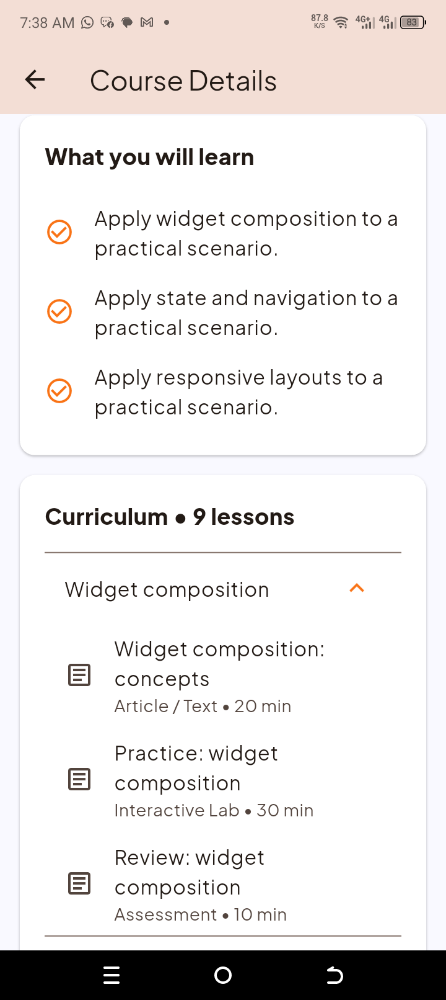](assets/images/screenshots/Screenshot_20261019-073819.png) |

### Learner experience

| Learner dashboard | Learning progress overview |
| --- | --- |
| [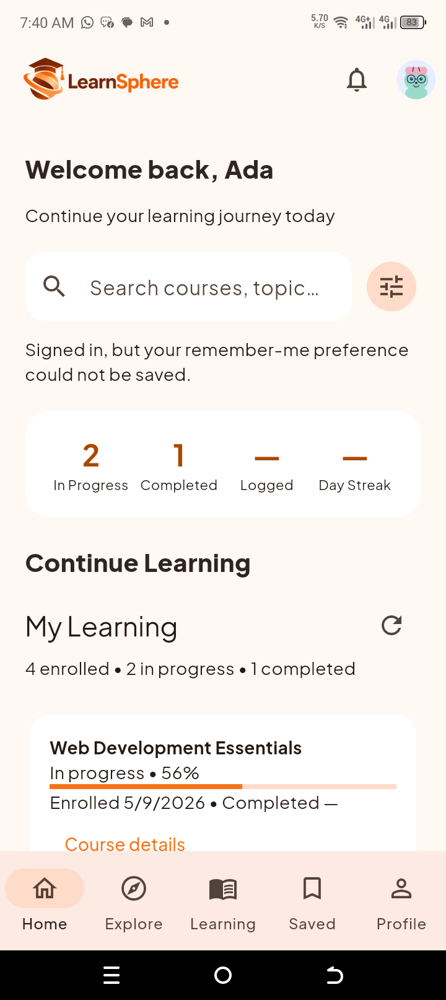](assets/images/screenshots/Screenshot_20261019-074007.png) | [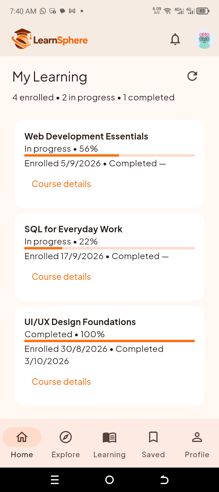](assets/images/screenshots/Screenshot_20261019-074024.png) |

| Course spotlight | Explore courses |
| --- | --- |
| [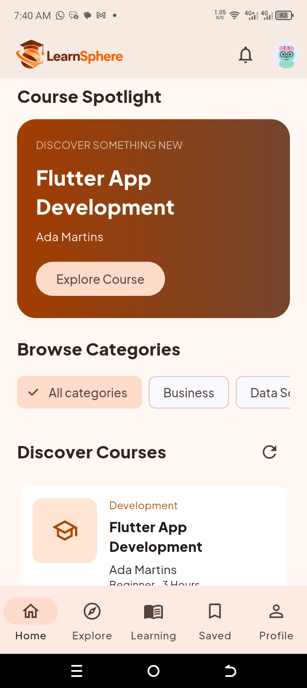](assets/images/screenshots/Screenshot_20261019-074033.png) | [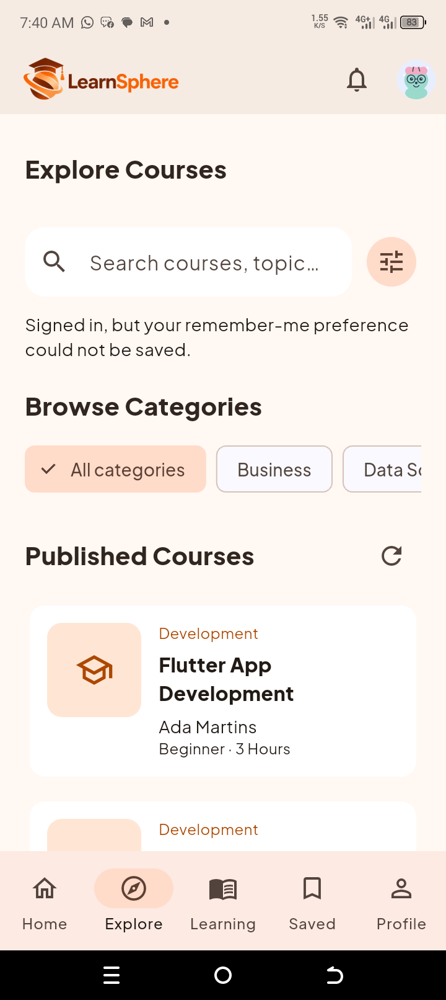](assets/images/screenshots/Screenshot_20261019-074042.png) |

| My Learning | Edit profile |
| --- | --- |
| [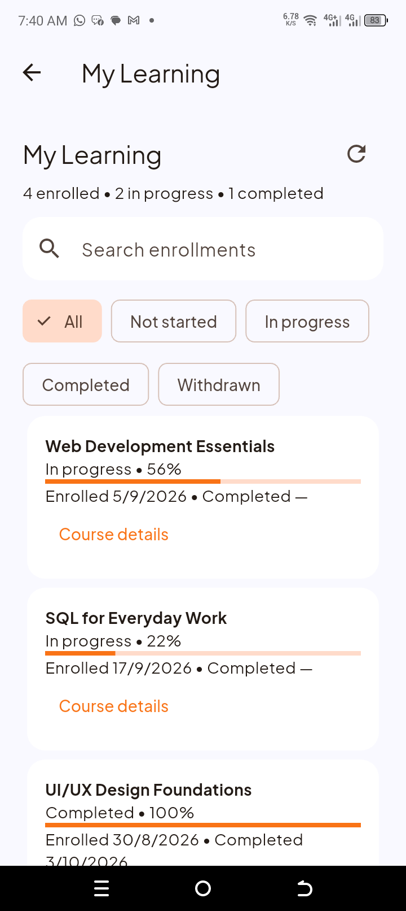](assets/images/screenshots/Screenshot_20261019-074049.png) | [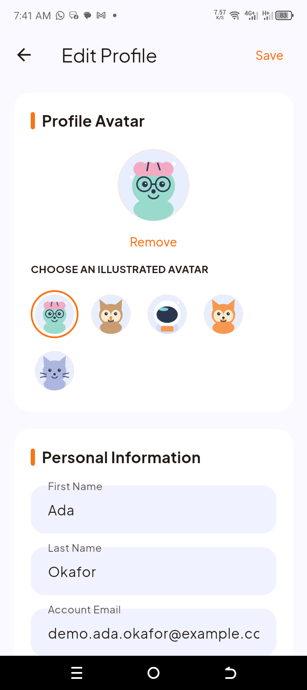](assets/images/screenshots/Screenshot_20261019-074100.png) |

## Setup

Create `jsonbin.local.json` in the project root (ignored by Git):

```json
{
  "JSONBIN_USERS_BIN_ID": "YOUR_USERS_BIN_ID",
  "JSONBIN_COURSES_BIN_ID": "YOUR_COURSES_BIN_ID",
  "JSONBIN_ENROLLMENTS_BIN_ID": "YOUR_ENROLLMENTS_BIN_ID",
  "JSONBIN_ACCESS_KEY": "YOUR_READ_WRITE_ACCESS_KEY"
}
```

Initialize separate bins with `{"users":[],"last_id":0}`, `{"courses":[]}`,
and `{"enrollments":[]}`. An administrator must already exist as an active user
with `account_type: "admin"`; self-registration creates learners only.

```powershell
flutter pub get
flutter run --dart-define-from-file=jsonbin.local.json
flutter build apk --release --dart-define-from-file=jsonbin.local.json
```

Restart or rebuild after configuration changes. On Windows, enable Developer Mode
if Flutter reports that plugins require symlink support.

Keys need Bin Read and Bin Update permissions. `JSONBIN_MASTER_KEY` can replace
the shared access key. Per-bin settings such as `JSONBIN_COURSES_ACCESS_KEY` and
`JSONBIN_COURSES_MASTER_KEY` independently override shared values; a nonblank
master key takes precedence. Set a per-bin master key to `""` to use only that
bin's access key. `JSONBIN_USERS_BIN_ID` overrides the legacy `JSONBIN_BIN_ID`;
if both are absent, the app retains its original users-bin default. Courses and
enrolments require explicit bin IDs. Use distinct bins for the three domains.

## Features

- Learners can register, sign in with email or username, update their profile,
  and recover access using their saved security question.
- Administrators can create and manage learners, edit profiles, author courses,
  and publish, archive, duplicate, or restore courses to draft.
- Learners can search published courses, inspect curricula, enrol, resume lessons,
  mark lessons complete, and withdraw. Re-enrolment restores retained progress.
- Administrators can assign published courses and inspect progress, completion
  dates, dashboard totals, trends, and recent enrolment activity.
- Profiles include illustrated avatars, interests, professional links, and saved
  privacy and reminder preferences.

Lessons support text, lab instructions, self-assessments, and hosted HTTPS video
links. Videos open externally. Existing enrolments retain access if their course
becomes draft or archived. Completion uses current lesson IDs; adding or removing
lessons can change progress. Opening a lesson saves the resume position; only
marking it complete changes completion progress.

## Demo data

```powershell
dart run tool/seed_jsonbin.dart --preview
dart run tool/seed_jsonbin.dart --apply
```

The seed adds 20 fictional learners (18 active), 10 courses (8 published, 1 draft,
1 archived), and 60 enrolments: 15 not started, 25 in progress, 15 completed, and
5 withdrawn. The two inactive learners have no enrolments. Existing records and
administrator accounts are preserved. Reruns retain edits and avoid duplicates;
identity conflicts stop the seed. An active administrator is required.

Example sign-in: select **Learner**, username `demo.ada.okafor`, initial password
`LearnSphere123!`. The recovery answer is `LearnSphere`. These are test credentials;
reruns do not reset passwords changed through the app.

Apply saves original records and initial learner sign-ins under
`.local/seed-backups/<timestamp>/`, then writes users, courses, and enrolments in
order and verifies read-back. Keep backups private: they contain account data.
If a write fails, inspect the reported confirmed writes and current stores before
retrying. Stable seed identities allow reruns to finish a partial seed.

To replace the original generic demo lessons with subject-specific content:

```powershell
dart run tool/update_seed_content.dart --preview
dart run tool/update_seed_content.dart --apply
```

The updater changes only recognized demo lessons whose content exactly matches
the original seed text. Edited or missing lessons are skipped; already updated
lessons are unchanged. It backs up courses, preserves IDs and all other fields,
and verifies read-back. It never writes users or enrolments. Both commands accept
`--config=path.json`; preview is the default mode.

## Testing

```powershell
flutter analyze --no-pub
flutter test --no-pub
```

Automated tests use fake repositories and mocked HTTP. Use separate test bins for
manual registration, recovery, enrolment, withdrawal, and progress checks. Check
both roles and narrow and wide layouts. Seed/update commands contact live bins
only when explicitly run.

## Current limitations

JSONBin credentials ship with the client and application roles are checked on the
client. Passwords and recovery answers are readable values; `password_hash` is a
legacy name, not a cryptographic hash. This setup is for a prototype, not
production authentication. Recovery has no email verification, OTP, or attempt
limiting. Sessions are not restored after restart.

JSONBin replaces whole records and has no transaction across bins. Concurrent
writers can overwrite changes, so avoid other edits while seeding or updating
content. Commands check for intervening edits before writing, but cannot eliminate
the race. A timed-out save may still reach the server; refresh before retrying.

Social sign-in, SSO, biometrics, notifications, exports, study-time tracking,
streaks, saved courses, public profiles, and reminder delivery are unfinished.
Privacy/reminder preferences are stored only. Labs are instructions rather than
executable environments; assessments have no automatic grading. Photo/file
uploads and embedded video playback are unsupported. Terms and privacy dialogs
still need final policy content. Views without an enrolment repository show an
unavailable state rather than claiming there are no enrolments.

Plus Jakarta Sans is bundled; its license is in `assets/fonts/OFL.txt`.

   ## What changed in Week 3
   - Home, Explore and Course Details now load data from a JSON store (JSONBin).
   - Forms with validation: Sign In, Registration, Password Recovery, Admin Course.
   - Loading spinners, error messages with Retry, and empty states.
   - Full details: see CHANGELOG_WEEK3.md